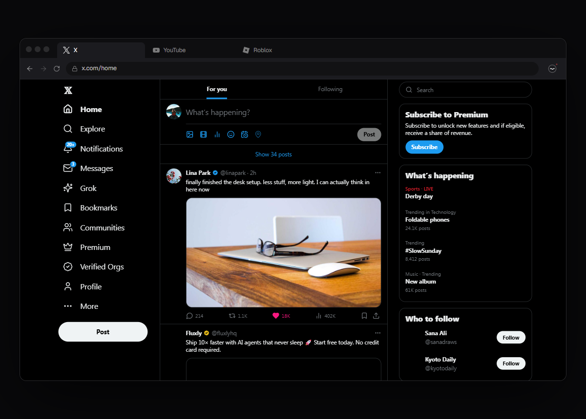
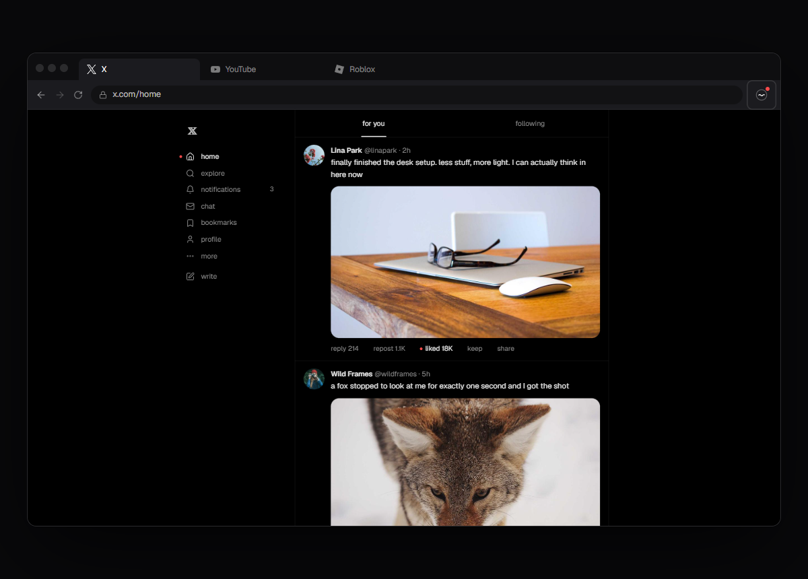
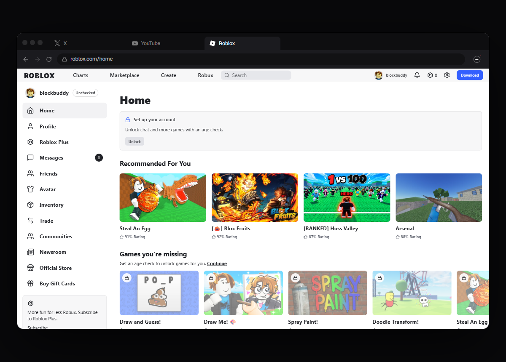
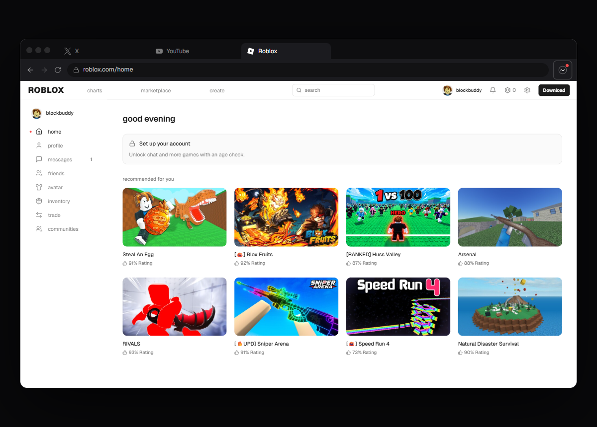

<div align="center">


# hush

**The web is loud. hush turns it down.**

**[save.github.io/hush](https://save.github.io/hush/)**

A free, open-source browser extension that strips the promos, badges and noise from X, YouTube, Roblox, GitHub and Reddit, and gives them calmer layouts you can actually think in.

[](LICENSE)
[](manifest.json)
[](CHANGELOG.md)
[](PRIVACY.md)

<br />


</div>

<br />

## Before and after

| | Today | With hush |
| :-- | :--: | :--: |
| **X** |  |  |
| **Roblox** |  |  |

## Features

- **Tailored for X, YouTube, Roblox, GitHub and Reddit.** Each site has its own adapter that removes upsells, ads, Shorts, trends, Copilot nudges and promoted posts, and rebuilds the page in one quiet palette.
- **Hush anything.** Right-click any element on any site and choose **hush this**. It stays hidden until you bring it back from `Ctrl K` or settings.
- **Mute words.** Hide posts, videos and games that mention anything you choose. Type `mute crypto` in `Ctrl K`.
- **Calm titles.** ALL CAPS, [🔥UPDATE] tags, emoji and "!!!" taken out of YouTube, Roblox and Reddit titles. Hover for the original.
- **Gentle time nudges.** Optional: a quiet note after 20, 45 or 90 minutes on a site each day.
- **A weekly quiet report.** See how much hush kept off your screen this week, and your time per site. Counted on your device only.
- **Calm every site.** Sites without a tailored adapter still lose display ads, chat bubbles, notification nags and "subscribe!" pop-ups.
- **Still motion.** Nothing autoplays. Video plays when you press play.
- **Soft colour.** Thumbnails stop shouting until you point at them. One slider sets how much.
- **`Ctrl K` everywhere.** Every switch, your weekly report and everything you've hidden, one keystroke away. The toolbar button opens it too.
- **Your menu, your way.** Sidebars as words, icons, or both.
- **Fast.** Throttled observers, no frameworks injected into pages. X scrolls at 160+ fps with hush on.

## Install

hush isn't on the Chrome Web Store yet. Until it is, installing takes three steps and under a minute (Chrome, Brave, Edge, Arc, Opera):

1. **[Download hush.zip](https://github.com/save/hush/releases/latest/download/hush.zip)** and unzip it somewhere you'll keep it. You get a folder called `hush`.
2. Open `chrome://extensions` (`brave://extensions` in Brave, `edge://extensions` in Edge) and switch on **Developer mode**, top right.
3. Click **Load unpacked**, choose the `hush` folder, and pin hush from the puzzle-piece menu.

**Brave:** hush and Shields work side by side. Shields blocks ads at the network level; hush calms what's left (layouts, upsells, Shorts, badges). Keep both on.

**To update:** download the newest zip, replace the folder, and press reload on hush's card in `chrome://extensions`. Your settings stay.

Building from source instead? Clone the repo and load the repo folder itself: the popup is already built.

## Keyboard

| Key | Does |
| :-- | :-- |
| `Ctrl K` / `⌘ K` | Open the palette: go anywhere, toggle anything |
| `Alt ⇧ H` | Turn hush on or off for this site |
| `z` | Focus mode |
| `/` | Search |
| `g` then a letter | Go to a page (Roblox: `g h` home, `g c` communities, `g a` avatar…) |

## Privacy

hush stores your settings in Chrome sync and its weekly counts in local storage. That's all. No analytics, no tracking, no servers, no ads or affiliate links. It never reads or sends what you browse. See [PRIVACY.md](PRIVACY.md).

## Development

```bash
npm install
npm run build        # the popup: ui/ → build/popup
npm run dev          # rebuild the popup on save
npm run site:dev     # the homepage at http://localhost:5180
npm run site:build   # the homepage → site/dist (static files)
npm run pack         # build, then pack the extension → release/hush.zip
```

After changing the extension, press reload on its card in `chrome://extensions` and refresh the tab.

```
manifest.json      the extension
src/core/          engine, palette, picker, shared registry and calm layer
src/sites/         one adapter per site (x, youtube, roblox, github, reddit)
ui/                the popup: React, shadcn/ui, Tailwind v4
site/              the homepage: React, Motion, a hand-written WebGL shader
docs/              site-by-site details and media
```

Every adapter rule is scoped under `html[data-hush-site="…"]`, so turning hush off is instant, with no reload. How each site is handled, the design system and how to add a site are in [docs/SITES.md](docs/SITES.md).

## Contributing

Site requests, bug reports and pull requests are welcome. Please read [CONTRIBUTING.md](CONTRIBUTING.md) first.

## Support

hush is free and always will be. If it made the web a little quieter for you, the popup has a **Support** link.

## License

[MIT](LICENSE)
